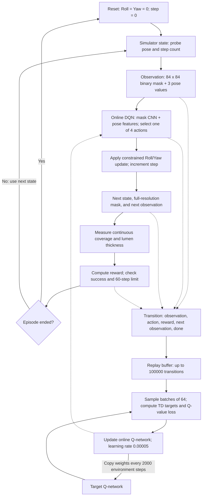

# View Transition RL — Project Overview

## Aim

Learn to orient a virtual ultrasound probe so that a vessel view changes from a transverse cross-section to a useful longitudinal section. The current task uses phantom 1 and controls only Roll and Yaw while keeping the probe position and Pitch fixed.

## Simulation environment

The self-contained VTK simulator slices vessel meshes at the probe imaging plane to generate **480×480 binary segmentation masks** over a **40×40 mm** field of view. It supports five probe degrees of freedom (surface X/Y translation and Roll/Pitch/Yaw), surface-contact and motion constraints, a Python API, and an interactive desktop GUI. Three phantoms are included: a reference vessel reconstructed from a real scan, a second vessel mesh, and a curved-arc vessel. Meshes and reference data are bundled with the project.

This is an ideal geometric segmentation simulator: it does not simulate ultrasound intensity, acoustics, tissue deformation, or segmentation noise.

## Reinforcement learning components

| Component | Current implementation |
| --- | --- |
| Environment | Gymnasium `ViewTransition/LongitudinalPhantom1-v0`; deterministic phantom 1 task. |
| State | Roll/Yaw grid position and episode step count; X, Y, and Pitch remain zero. There are 21×72 possible angle grid positions. Every episode starts at zero pose (transverse view). |
| Observation | Dictionary containing a `(1, 84, 84)` uint8 mask (0/255, downsampled and thresholded from the full mask) and `[roll/20°, sin(yaw), cos(yaw)]`. The step count is not observed. |
| Action | Four discrete actions: Roll −2°, Roll +2°, Yaw −5°, Yaw +5°. Absolute Euler angles are updated; Roll is limited to ±20° and Yaw wraps in [−180°, 180°). Rejected actions leave the pose unchanged. |
| Success | Longest uninterrupted run of nonempty mask columns covers at least 95% of image width **and** mean lumen thickness across nonempty columns is at least 4.5 mm. Metrics use the full-resolution mask. |
| Episode end | Terminates on success; otherwise truncates after 60 actions. |
| Algorithm | Stable-Baselines3 DQN with `MultiInputPolicy`: CNN features from the mask are combined with pose features to predict action values. Training uses experience replay, a target Q-network, and epsilon-greedy exploration. |

The reward encourages improvement in longitudinal coverage and thickness:

```text
Φ = 0.7 × continuous_column_coverage + 0.3 × min(thickness_mm / 4.5, 1)
reward = 10 × (Φ_next − Φ_current) − 0.05
         − 0.2 if the action is rejected
         + 10 if the success criteria are met
```

The saved run trained for **100,000 environment steps**, seed **0**, with learning rate **5e-5**, discount **0.95**, replay capacity **100,000**, batch size **64**, learning starting after **1,000** steps, training every **4** steps, and target updates every **2,000** steps. Exploration epsilon decreases from **1.0 to 0.05** over the first 30% of training. Deterministic evaluation runs every 5,000 steps. See the [saved run configuration](outputs/training/dqn_longitudinal/config.json).

## Worked examples: observations, actions, and rewards

The first two examples are actual transitions in the saved final-model trajectory. X, Y, and Pitch are zero throughout. Each observation contains the binary mask array `(1, 84, 84)` plus the numerical pose vector below; coverage and thickness are computed from the full-resolution mask for reward calculation, not supplied as separate policy inputs. Angles inside sine/cosine are converted to radians.

| Value | First action: step 0 → 1 | Successful action: step 18 → 19 |
| --- | --- | --- |
| State before: (Roll, Yaw, step) | (0°, 0°, 0) | (2°, −85°, 18) |
| Pose observation before | `[0, 0, 1]` | `[0.1, −0.996195, 0.087156]` |
| Chosen action | `2`: Yaw −5° | `1`: Roll +2° |
| State after | (0°, −5°, 1) | (4°, −85°, 19) |
| Pose observation after | `[0, −0.087156, 0.996195]` | `[0.2, −0.996195, 0.087156]` |
| Continuous column coverage | 0.1125 → 0.1125 | 1.0 → 1.0 |
| Mean lumen thickness | 4.927469 → 4.933642 mm | 3.552778 → 4.932118 mm |
| Potential Φ | 0.37875 → 0.37875 | 0.936852 → 1.0 |
| Step reward | **−0.05** | **+10.581481** |
| Episode flags after action | `terminated=False, truncated=False` | `terminated=True, truncated=False` |

For the first action, thickness exceeds 4.5 mm before and after, so the capped thickness term equals 1. Coverage is unchanged:

```text
Φ_before = Φ_after = 0.7 × 0.1125 + 0.3 × 1 = 0.37875
reward = 10 × (0.37875 − 0.37875) − 0.05 = −0.05
```

For the final action, full-width coverage alone was insufficient at step 18 because the lumen was too thin. Roll +2° increases thickness past the threshold:

```text
Φ_before = 0.7 × 1 + 0.3 × (3.552777778 / 4.5) = 0.936851852
Φ_after  = 0.7 × 1 + 0.3 × 1 = 1
reward = 10 × (1 − 0.936851852) − 0.05 + 10 = 10.58148148
```

**Hypothetical rejected action:** at a nonterminal state with Roll +20°, Yaw 0°, and step 10, action `1` requests Roll +22°. The ±20° limit rejects it. Roll/Yaw and observation `[1, 0, 1]` (plus its mask) stay unchanged, the step count becomes 11, and `rejected=True`. With no potential change or success bonus, reward is `0 − 0.05 − 0.2 = −0.25`.

These are individual step rewards. The actual saved episode's **undiscounted return is 15.2625**, the sum of all 19 rewards. DQN's discount factor of 0.95 is used for learning future action values; it is not a multiplier in the environment's immediate reward formula. The recorded actions come from deterministic policy evaluation; training additionally explores with random actions.

## RL pipeline



The solid interaction loop produces experience; the replay branch updates the policy during training. Training selects actions with epsilon-greedy exploration. Evaluation chooses the highest-valued action deterministically and performs no replay-buffer learning or network updates. The diagram's `done` summarizes episode ending; the environment separately reports success termination and time-limit truncation.

Plain-text version for viewers without Mermaid support:

```text
Reset -> State -> Mask + pose -> DQN action -> Constrained pose update
           ^                                  |
           |       Next mask + metrics <------+
           |                |
           +-- continue -- Reward / episode end -- reset

Transition -> Replay buffer -> Batch + target Q-network -> Update online DQN
                                                               |
                                  Periodic target weight copy <-+
```

## Current training result

Both the [best-model evaluation](outputs/evaluation/dqn_longitudinal_best_model/summary.json) and [final-model evaluation](outputs/evaluation/dqn_longitudinal_final_model/summary.json) report success in **19 actions**, with return **15.2625**. Each finishes at **Roll +4°, Yaw −85°**, with **100% continuous column coverage** and **4.932 mm mean lumen thickness**. The saved training evaluation log shows consistent 19-step successes from 65,000 through 100,000 training steps.

Each saved model summary contains **one deterministic episode from the fixed starting pose**. Its reported 100% success rate demonstrates this particular task; it does not establish robustness to different initial poses, phantoms, noise, or real ultrasound data. The [trajectory video](outputs/evaluation/dqn_longitudinal_final_model/trajectory.mp4), [trajectory CSV](outputs/evaluation/dqn_longitudinal_final_model/trajectory.csv), and [final mask](outputs/evaluation/dqn_longitudinal_final_model/final_mask.png) are included, along with all models, checkpoints, and logs.

## Run the shared copy

Use Python 3.10 or newer. From this folder, create your own environment and install the declared dependencies:

```bash
python3 -m venv .venv
source .venv/bin/activate
python -m pip install -e '.[gui,rl]'
python -m view_transition_rl sim gui

# Evaluate the included policy without replacing the saved evaluation
python -m view_transition_rl.evaluation.evaluate_policy --model outputs/training/dqn_longitudinal/best_model.zip --output outputs/evaluation/shared_check

# Train a new run in a separate output folder
python -m view_transition_rl.training.train_dqn --config configs/training/dqn_longitudinal.json --output outputs/training/new_run
```

The GUI and video rendering require an available OpenGL backend. This copy excludes installed virtual environments, IDE settings, caches, build outputs, and generated package metadata. Dependency declarations are preserved in `setup.cfg`; no environment is bundled. All documentation in this shared copy is in English.
