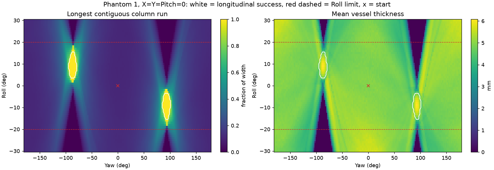

# RL task: Phantom 1 transverse to longitudinal view

Implementation: `src/view_transition_rl/envs/`. Configuration: `configs/tasks/longitudinal_phantom1.json`.

## Task

- Phantom 1 (`reference`) is a reconstructed vessel running approximately along phantom +Y, offset by about 4.3°. At y=0 its centerline is near x=−2.5 mm, at depths of approximately 8–18 mm.
- Initial pose: X=Y=Roll=Pitch=Yaw=0, a transverse view with continuous column coverage 0.1125. The task explicitly resets to zero; the underlying `PhantomEnv.reset()` instead replays reference frame 95 for this model.
- Only Roll and Yaw change. X, Y, and Pitch remain fixed.
- Gymnasium ID: `ViewTransition/LongitudinalPhantom1-v0`. Call `view_transition_rl.envs.register_envs()` before `gymnasium.make(...)`, or instantiate `LongitudinalViewEnv()` directly.

## Longitudinal-view criterion

Both conditions must hold:

1. **Longest continuous column coverage ≥0.95:** the longest uninterrupted run of nonempty columns occupies at least 95% of image width. Total nonempty-column coverage alone can combine disconnected regions; requiring exactly 100% is sensitive to boundary pixels.
2. **Mean lumen thickness ≥4.5 mm:** average height across nonempty columns, approximately 75% of the best slice thickness of 6.1 mm. This excludes grazing slices: Roll −18°, Yaw 94° spans the image width but is only about 2.4 mm thick.

The criteria use only masks via `envs/metrics.py`, without privileged centerline information.

## Reachable region

`scripts/tasks/scan_longitudinal_region.py` scans Roll/Yaw at 1°×2° spacing with X=Y=Pitch=0. Results are in `reports/tasks/longitudinal_phantom1/`.

| Region | Roll | Yaw |
| --- | --- | --- |
| Forward | −15 to −4° | 86 to 100° |
| Reverse (same plane, horizontally flipped image) | +4 to +15° | −94 to −80° |

The best scanned pose is Roll −9°, Yaw 94°. With Roll=0, continuous coverage does not exceed 0.47 for any Yaw; the approximately 2.5 mm vessel offset requires a tilted plane.



## Actions, limits, and observations

- Maintain absolute Euler angles and call `set_pose(pose_from_euler(0, 0, roll, 0, yaw))`. Local increments through `PhantomEnv.step()` would accumulate Pitch because local Rx and Rz do not commute.
- `Discrete(4)`: action 0 = Roll −2°, 1 = Roll +2°, 2 = Yaw −5°, 3 = Yaw +5°. These increments sample the approximately 14° Yaw and 11° Roll success windows. A forward route takes about 20 actions; the included policy finds a 19-action reverse route.
- Roll is limited to ±20°, allowing margin around the successful region. Out-of-range actions are rejected and penalized. Yaw wraps in [−180°, 180°).
- Observation dictionary: `mask` is `(1, 84, 84)` uint8, BOX-downsampled from 480×480 and thresholded to 0/255; `pose` is `[roll/20°, sin(yaw), cos(yaw)]`.
- Each environment caches masks and metrics for its 21×72 angle grid positions.

## Reward and termination

```text
Φ = 0.7 × column_run + 0.3 × min(thickness / 4.5 mm, 1)
r = 10 × (Φ_next − Φ_current) − 0.05
Rejected action: additional −0.2
Success: additional +10 and terminated=True
No success after 60 actions: truncated=True
```

`info` contains `roll_deg, yaw_deg, column_run, coverage, thickness_mm, success, rejected, steps`.

## Training and evaluation

```bash
python -m pip install -e '.[rl]'
python -m view_transition_rl.training.train_dqn --config configs/training/dqn_longitudinal.json --output outputs/training/new_run
python -m view_transition_rl.evaluation.evaluate_policy --model outputs/training/dqn_longitudinal/best_model.zip --output outputs/evaluation/new_evaluation
python -m view_transition_rl.evaluation.render_video --trajectory outputs/evaluation/dqn_longitudinal_final_model/trajectory.csv
```

Video rendering shows the 3D phantom, probe and plane, live mask, pose sliders, action, step, metrics, and success status. The default output is `trajectory.mp4` alongside the CSV: 15 fps, six interpolated frames per action, and 1.5-second holds at each end. Every frame recomputes the geometric slice. A working offscreen OpenGL backend is required.

Training uses SB3 `DQN("MultiInputPolicy")`: NatureCNN extracts mask features; flattened pose features are concatenated before the Q-network's fully connected layers. Outputs include best/final models, checkpoints, Monitor CSV, and TensorBoard logs. Evaluation exports `trajectory.csv`, `summary.json`, and `final_mask.png`.

The saved seed-0 run uses 100,000 steps, gamma 0.95, a 100,000-transition replay buffer, learning rate 5e-5, and target updates every 2,000 steps. Evaluation succeeds from 60,000 steps onward, reaching a consistent 19 actions from 65,000 through 100,000 steps. Best and final models each succeed in one saved deterministic episode. This does not measure performance across different starts or phantoms.

Historical development notes describe instability with gamma 0.99: an initial 50,000-capacity buffer and learning rate 1e-4 reached approximately 60% training-episode success near 23,000 steps, then fell to approximately 2%; a 100,000-capacity buffer and learning rate 5e-5 also became unstable. Those notes attributed this partly to loss of early successful experience and motivated a shorter discount horizon. These are historical observations, not additional benchmark results established by the included final evaluation summaries.
